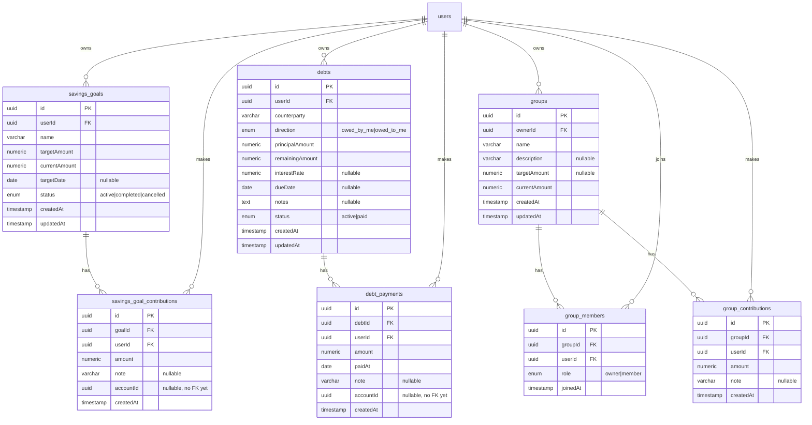

# ERD: Savings Goals, Debts, Groups

Paste the Mermaid block into https://mermaid.live or any Mermaid viewer.

## Constraints
- `group_members`: unique on (`groupId`, `userId`).
- Money columns are `numeric(12,2)`; `interestRate` is `numeric(5,2)`.
- `amount`, `targetAmount`, `principalAmount` have `CHECK > 0`; `currentAmount`, `remainingAmount` have `CHECK >= 0`.
- FKs to `users` and parent tables use `ON DELETE CASCADE`.
- Indexes: `savings_goals(userId)`, `debts(userId)`, `group_members(userId)`, plus `goalId` / `debtId` / `groupId` on the child tables.
